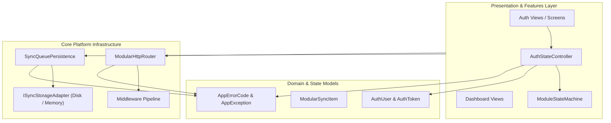
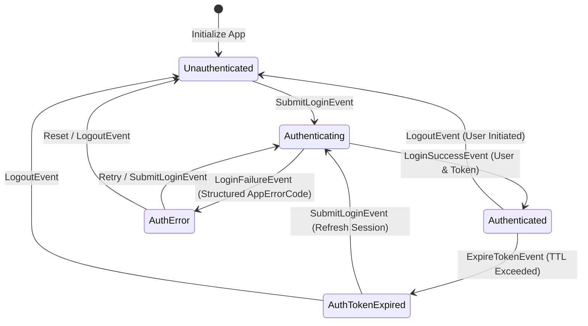

# 📱 flutter-modular-template

[](https://github.com/MobileConduit/flutter-modular-template/actions)
[](LICENSE)
[](https://github.com/MobileConduit)
[](https://dart.dev)

An enterprise-ready Flutter application starter kit implementing Feature-First packaging, deterministic State Machine controllers, decoupled HTTP routing with middleware, structured error codes, and offline sync queue persistence.

---

## 🏛️ System Architecture

### Component Hierarchy Diagram



---

## 🔄 State Machine & Transition Flow



---

## ⚡ Key Architectural Capabilities

1. **Feature-First Organization:** Segregates code by business capability (`features/auth`, `features/dashboard`) containing self-contained presentation, domain, and data layers.
2. **Deterministic State Machine:** Encapsulates allowed transitions between UI states, preventing invalid state mutations and race conditions.
3. **Modular HTTP Router & Middleware:** Declarative routing with path parameters, structured request/response pipelines, and typed exception boundaries.
4. **Structured Error Codes:** Domain-driven error enumeration (`AppErrorCode`) providing consistent codes (`AUTH_001`, `NET_001`, `ROUTE_404`, `SYNC_001`, `STATE_001`).
5. **Sync Queue Persistence:** Offline-first synchronization queue with FIFO dispatching, deduplication, item status tracking, and pluggable storage adapters.

---

## 📁 Project Directory Structure

```text
flutter-modular-template/
├── .github/
│   └── workflows/
│       └── ci.yml               # Automated CI/CD pipeline
├── lib/
│   ├── core/
│   │   ├── errors/
│   │   │   └── app_error_codes.dart      # Standardized error codes & exceptions
│   │   ├── network/
│   │   │   ├── http_router.dart          # HTTP router and middleware engine
│   │   │   └── network_models.dart       # Request, response, and method models
│   │   ├── state/
│   │   │   └── state_machine.dart        # Finite state machine transition engine
│   │   └── sync/
│   │       └── sync_queue_persistence.dart # Sync queue & storage adapter
│   ├── features/
│   │   └── auth/
│   │       ├── domain/models/
│   │       │   └── auth_user.dart        # User and token domain models
│   │       └── presentation/
│   │           └── auth_state_controller.dart # State machine controller
│   └── main.dart                         # Entry point and modular exports
├── test/
│   ├── http_routing_test.dart            # HTTP routing & middleware unit tests
│   ├── state_transitions_test.dart       # State machine transition unit tests
│   └── sync_queue_persistence_test.dart  # Queue persistence unit tests
├── .env.example                          # Environment configuration template
├── pubspec.yaml                          # Dart/Flutter package configuration
└── README.md                             # Documentation & architecture specifications
```

---

## 🚀 Getting Started

### Prerequisites
- Dart SDK `^3.0.0` or Flutter SDK `^3.10.0`

### Installation
```bash
# Clone the repository
git clone https://github.com/MobileConduit/flutter-modular-template.git
cd flutter-modular-template

# Install dependencies
dart pub get

# Setup environment variables
cp .env.example .env
```

### Running Tests and Static Analysis
```bash
# Verify formatting
dart format --output=none --set-exit-if-changed .

# Run static analysis
dart analyze --fatal-infos

# Run full test suite
dart test
```

---

## 👤 Author & Maintainer

**Eng. MHD. Shadi AL-Hasan**  
- **Role:** Executive CTO & Enterprise Solutions Architect  
- **Email:** [mhd.shadi.alhasan@gmail.com](mailto:mhd.shadi.alhasan@gmail.com)  
- **Phone / WhatsApp:** [+963934005922](tel:+963934005922)  
- **Location:** Damascus, Syria  
- **GitHub:** [MobileConduit](https://github.com/MobileConduit)  

---

## 📄 License

This project is licensed under the MIT License - see the [LICENSE](LICENSE) file for details.  
Copyright (c) 2026 **MHD. Shadi AL-Hasan**. All rights reserved.
